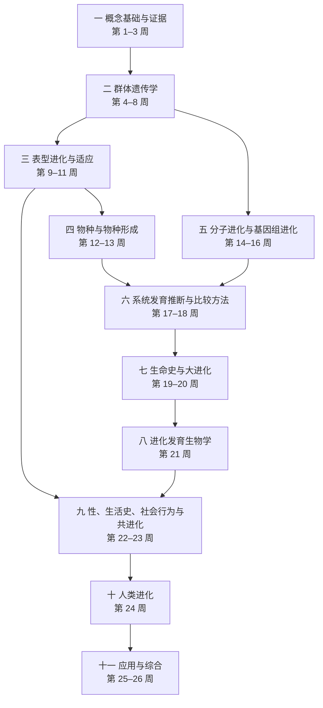

# 学习路线（Roadmap）

## 1 总体学习目标

完成全部课程后，学习者应能够：

1. 用数学模型描述突变、选择、漂变、迁移与重组如何改变群体的遗传组成，并理解模型的假设；
2. 从基因组数据中推断人口历史与自然选择，识别主要的混杂因素与方法局限；
3. 进行系统发育推断与比较分析，理解物种形成机制与大进化格局；
4. 在分子、发育、个体、群体与谱系等层次上整合解释生物性状；
5. 批判性地阅读进化生物学的一手文献，并设计可检验的研究问题。

## 2 先修与准备

| 方面 | 要求 | 不足时的补充 |
|---|---|---|
| 生物学 | 本科遗传学与分子生物学基础 | OpenStax *Biology 2e* 第 12–17 章 |
| 数学 | 微积分初步；概率论（二项分布、泊松分布、指数分布、期望与方差）；线性代数（矩阵乘法） | 第 4–9 周涉及的推导在讲义中会给出步骤 |
| 计算 | R 或 Python 基础 | 第 7 周前安装 Python 的 msprime、tskit；第 17 周前安装 IQ-TREE 2；第 18 周前安装 R 的 ape、phytools；第 26 周前安装 SLiM |
| 时间 | 每天 60–90 分钟；复盘日约 90 分钟 | 进度落后时，优先保证讲义与练习，选读材料可推迟 |

## 3 路线总览

## 4 各部分的学习成果与主要资源

| 部分 | 核心问题 | 学习成果 | 主要免费资源 |
|---|---|---|---|
| 一 概念基础与证据（第 1–3 周） | 什么是进化？我们如何知道它发生过？变异从何而来？ | 掌握进化的定义与解释层次；能评价进化的多重证据；能正确读树；理解突变与重组 | UE；Yale EEB 122；OpenStax 第 18–20 章；Darwin Online |
| 二 群体遗传学（第 4–8 周） | 选择、漂变、迁移与突变如何定量地改变群体？ | 能推导单位点模型；理解 Nₑ、F 统计量与溯祖；能用 msprime 做模拟 | Coop；Holsinger；Felsenstein；msprime / tskit；*Statistical Population Genomics* |
| 三 表型进化与适应（第 9–11 周） | 复杂性状如何响应选择？如何从数据中检测选择？ | 掌握育种者方程与 Lande 方程；理解适应的遗传结构；能比较各类选择检验 | Coop；*Evolutionary Genomics*；HHMI 案例 |
| 四 物种与物种形成（第 12–13 周） | 新物种如何形成？基因组如何记录物种形成与杂交？ | 辨析物种概念；理解 BDM 不相容；能解释 ABBA–BABA 与分化岛 | OpenStax §18.2–18.3；evomics 群体与物种形成基因组学 |
| 五 分子进化与基因组进化（第 14–16 周） | 序列与基因组如何进化？新基因从何而来？ | 掌握替代模型与 dN/dS；理解基因复制、WGD、从头起源基因、TE 与基因组大小 | *Evolutionary Genomics*；*Phylogenetics in the Genomic Era* |
| 六 系统发育推断与比较方法（第 17–18 周） | 如何重建生命之树，并用树检验进化假说？ | 能用 IQ-TREE 建树；理解 MSC 与定年；能做 PGLS 与祖先状态重建 | Lewis EEB 5349；IQ-TREE；RevBayes；Taming the BEAST；Harmon PCM |
| 七 生命史与大进化（第 19–20 周） | 生命史上的主要事件是什么？大进化格局如何产生？ | 了解生命起源、真核起源与主要转变；评价间断平衡、大灭绝与关键创新 | Yale EEB 122；Harmon PCM；开放获取综述 |
| 八 进化发育生物学（第 21 周） | 形态如何通过发育的改变而进化？ | 理解工具包基因、Hox 与顺式调控进化；评价扩展进化综合的主张 | HHMI 案例；开放获取综述 |
| 九 性、生活史、社会行为与共进化（第 22–23 周） | 性、合作与共进化如何在选择下维持与演变？ | 掌握 Hamilton 法则、Price 方程与 ESS；理解性选择与生活史理论 | Yale EEB 122；SEP 相关条目 |
| 十 人类进化（第 24 周） | 人类从何而来？古人类基因组告诉我们什么？ | 了解人族化石证据；理解古 DNA 与基因渗入；分析人类近期适应案例 | *Explorations*；Smithsonian Human Origins |
| 十一 应用与综合（第 25–26 周） | 进化理论如何用于医学、农业与保护？如何做进化研究？ | 能将进化思维用于实际问题；完成一个研究设计 | *Evolution, Medicine & Public Health*；SLiM；msprime |

## 5 阶段性项目

| 编号 | 时间 | 项目 | 产出 |
|---|---|---|---|
| M1 | 第 3 周末 | 用 Tinbergen 四问分析自己研究体系中的一个性状 | 1500 字短文 |
| M2 | 第 7 周末 | 用 msprime 比较恒定群体与瓶颈群体的 SFS、π、θ_W 与 Tajima's D | 代码与结果说明 |
| M3 | 第 11 周末 | 对模拟数据（或一段公开数据）做多种选择检验，并讨论人口史的混杂 | 分析报告 |
| M4 | 第 13 周末 | 研读一篇物种形成基因组学论文，写结构化评论 | 评论（问题、方法、结论、局限） |
| M5 | 第 16 周末 | 为一个基因家族设计"系统发育 + dN/dS"分析方案 | 分析方案 |
| M6 | 第 18 周末 | IQ-TREE 建树，并用 phytools 做祖先状态重建或 PGLS | 代码、树图与解释 |
| M7 | 第 26 周末 | 综合项目：提出一个进化问题，完成文献综述与研究设计（含模拟验证） | 研究计划书 |

## 6 方向进阶

| 方向 | 课程中的重点 | 课后进阶资源 |
|---|---|---|
| 群体基因组学 | 第 4–11、13 周 | *Statistical Population Genomics*；evomics 群体与物种形成基因组学；tskit 教程 |
| 系统发育与比较基因组学 | 第 14–18 周 | *Phylogenetics in the Genomic Era*；*Evolutionary Genomics*；RevBayes 与 Taming the BEAST |
| 植物进化与特化代谢 | Day 087、101、110、132、137、145、153、160、173 | 相关开放获取综述与比较基因组学研究 |
| 进化理论 | 第 4–10、23 周 | Felsenstein, *Theoretical Evolutionary Genetics* |

## 7 学习方法建议

1. **主动回忆**：读完讲义后，先合上材料，用自己的话写出本讲的 3 个要点，再核对。
2. **推导优先**：遇到公式，先尝试独立推导；推导不出来时再看讲义步骤。
3. **三遍读文献**：第一遍读标题、摘要、图表与结论；第二遍读方法与结果；第三遍评价假设与替代解释。
4. **每周复盘**：复盘日完成综合练习与精读，并更新个人的概念图。
5. **以模拟检验直觉**：对任何"应该如此"的判断，尽量用一个小模拟（PopG、learnPopGen、msprime 或 SLiM）验证。
