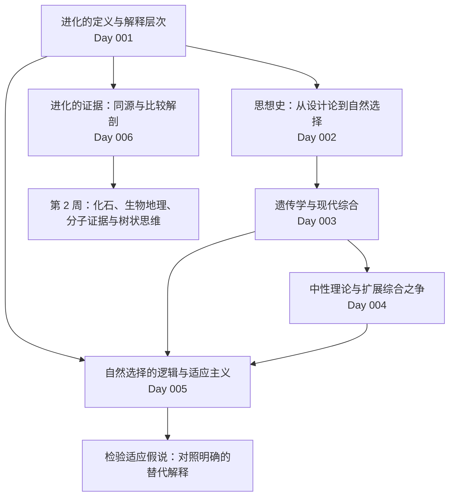

# Day 007 · 第 1 周复盘：进化生物学的问题、概念与思想史

> **部分** 第一部分 概念基础与证据 ｜ **周次** 第 1 周 ｜ **发布日期** 2026-11-09 ｜ **建议用时** 约 90 分钟
> **本周讲次** Day 001 至 Day 006
> **精读文献** Gould & Lewontin（1979）

## 1 本周知识结构

本周围绕三个问题展开。第一，**进化是什么**：它可以从群体遗传与谱系两个尺度来定义，关于进化的主张又分为模式、过程与历史三个层次。第二，**这一理论如何形成**：从自然神学对适应的关注，到达尔文与华莱士的自然选择，再到遗传学的整合、分子数据带来的中性理论，以及至今仍在进行的扩展综合之争。第三，**如何用证据检验进化解释**：适应假说需要与漂变、相关反应、约束等替代解释对照检验；比较生物学的证据则以同源概念为基础。

---

## 2 核心结论

1. 进化可以定义为群体遗传组成的跨世代改变，也可以定义为谱系中带有修饰的传承；关于进化的主张可分为模式、过程与历史三个逻辑上独立的层次（Day 001）。
2. 近因与终极因的区分以及 Tinbergen 四问要求对同一性状给出多层次的解释；发育等近因过程能否反过来影响选择（互惠因果），是扩展综合之争的焦点之一（Day 001、004）。
3. Lewontin 三条件（表型变异、适合度差异、适合度可遗传）同时成立时，群体就会因自然选择而进化；选择导致的频率变化与群体中的变异量成正比（Day 001）。
4. 达尔文与华莱士把 Malthus 的人口原理推广到所有生物，并与个体变异结合，提出了自然选择。达尔文的"进化论"实际上包含五个相互独立的子理论，它们被接受的速度各不相同（Day 002）。
5. 在融合遗传下，可遗传变异每代减半；颗粒遗传则能保存变异。Fisher（1918）用多因子模型调和了孟德尔学派与生物统计学派，为现代综合奠定了基础（Day 003）。
6. 在中性理论中，中性替代速率等于突变率，与群体大小无关；中性理论是检验选择的零模型。评价扩展综合时，应区分经验问题与概念问题（Day 004）。
7. 适应有历史与非历史两种定义；扩展适应与副产物提醒我们，不能把当前效用直接等同于选择历史。检验适应假说的关键是对照明确的替代假说（Day 005）。
8. 同源是比较生物学证据的基础，一致性检验把同源判断与系统发育联系起来；痕迹结构作为证据的价值，在于它与有功能结构的同源关系及其退化，而不在于"无用"（Day 006）。

---

## 3 公式与模型速查

| 模型或公式 | 表达式 | 主要假设 | 出处 |
|---|---|---|---|
| 单倍体选择 | $\Delta p = p(1-p)(w_A - w_a)/\bar{w}$ | 无性单倍体，离散世代，适合度恒定 | Day 001 |
| 选择下的优势比 | $\dfrac{p_t}{1-p_t} = R^{\,t}\,\dfrac{p_0}{1-p_0}$，$R = w_A/w_a$ | 同上 | Day 001 |
| 几何增长 | $N_t = N_0\,\lambda^{t}$ | 无密度制约 | Day 002 |
| 融合遗传下的方差 | $\operatorname{Var}(Y) = V/2$ | 随机交配，子代表型为亲代平均 | Day 003 |
| 多基因加性方差 | $\operatorname{Var}(G) = n a^2/2$ | $n$ 个独立加性位点，等位基因频率均为 1/2 | Day 003 |
| 漂变下的杂合度 | $H_t = H_0\,(1 - 1/2N)^{t}$ | 理想群体，无突变与选择 | Day 003 |
| 中性替代速率 | $k_0 = \mu_0$ | 严格中性，理想群体 | Day 004 |
| 有利突变的替代速率 | $k_a \approx 4N\mu_a s$ | $4Ns \gg 1$ | Day 004 |
| 中性杂合度 | $H = \theta/(1+\theta)$，$\theta = 4N_e\mu$ | 无限等位基因模型，平衡状态 | Day 004 |
| Jukes–Cantor 距离 | $d = -\tfrac34 \ln\!\left(1 - \tfrac43 p\right)$ | 四种碱基间等速率替代 | Day 004 |
| 最优窝卵数 | $c^* = (1 - b)/(2a)$ | 雏鸟存活与亲代代价随窝卵数线性变化 | Day 005 |

---

## 4 综合练习

1. **（概念）** 把下列陈述归入"模式""过程"或"历史"：(a) 所有现存生物源于共同祖先；(b) 分子水平的大多数替代由遗传漂变固定；(c) 人与黑猩猩的亲缘关系比人与猕猴更近；(d) 自然选择是适应的主要原因；(e) 哺乳类的中耳骨源自其祖先的颌关节骨。
2. **（思想史）** 将人物与观点配对。人物：Paley、Lamarck、Cuvier、Lyell、Malthus、Wallace、Weismann、de Vries、Fisher、Wright、Kimura、Gould 与 Vrba。观点：(a) 设计论证；(b) 复杂化趋势与获得性状遗传；(c) 灭绝的确立与灾变论；(d) 均变论；(e) 人口增长超过生活资料；(f) 沙捞越定律；(g) 种质学说；(h) 突变论；(i) 多因子模型与方差分解；(j) 近交系数与转移平衡理论；(k) 分子进化的中性理论；(l) 扩展适应。
3. **（计算）** 一个无性生殖群体有两种类型 A 与 a，初始共 1000 个个体，各占一半。每个 A 个体每代平均留下 $W_A = 1.1$ 个后代，每个 a 个体留下 $W_a = 1.0$ 个。(a) 10 代后群体大小与 A 的频率各是多少？(b) 若环境恶化，两者的绝对适合度都乘以 0.9（$W_A = 0.99$，$W_a = 0.90$），10 代后又如何？(c) 由此说明绝对适合度与相对适合度分别决定什么。
4. **（推导）** 在融合遗传下，设每代新突变为群体增加的遗传方差为 $M$，则 $V_{t+1} = V_t/2 + M$。(a) 求平衡方差 $V^*$；从 $V_0 = 0$ 出发，多少代后达到平衡值的 99%？(b) 在孟德尔遗传下，若遗传方差只因漂变按每代 $(1 - 1/2N)$ 的比例衰减，维持方差 $V$ 每代需要多少突变输入？(c) 两种遗传方式所需突变输入之比是多少？$N = 10^4$ 时为多少？这与 Fisher 的论证有何关系？
5. **（计算）** 两物种分歧 1000 万年，某类中性位点的替代速率为 $2 \times 10^{-9}$ /位点/年。按 Jukes–Cantor 模型，两条序列间的期望替代数 $d$ 与期望观测差异比例 $p$ 各是多少？为什么 $p < d$？
6. **（应用）** 用 Tinbergen 四问分析"某植物的开花时间随纬度而变化"，每一问各提出一个可检验的问题和一种研究方法。
7. **（研究设计）** 某岛屿上一种蜥蜴的后肢相对长度明显短于大陆种群。除"适应岛屿栖息环境"外，提出至少三种替代解释，并说明如何区分它们。
8. **（计算）** 系统发育树为 ((A,B),(C,(D,E)))。三个二态性状在 A–E 中的状态依次为 x = 11000，y = 01100，z = 11110。用 Fitch 简约法计算各性状所需的最少步数，并说明：哪个性状支持树中的某个单系群？哪个性状意味着同塑？z 虽然只需 1 步，为什么不能把它的状态"1"当作 A–D 的共有衍征？

答案要点

1. (a) 模式；(b) 过程；(c) 历史（系统发育关系）；(d) 过程；(e) 历史（性状的演化史）。模式与历史的界线有时并不截然分明。
2. Paley—(a)；Lamarck—(b)；Cuvier—(c)；Lyell—(d)；Malthus—(e)；Wallace—(f)；Weismann—(g)；de Vries—(h)；Fisher—(i)；Wright—(j)；Kimura—(k)；Gould 与 Vrba—(l)。
3. (a) $N_A = 500 \times 1.1^{10} \approx 1296.87$，$N_a = 500$，群体约 1796.87，A 的频率约 0.7217。(b) $N_A \approx 452.19$，$N_a \approx 174.34$，群体约 626.53（在缩小），但 A 的频率仍约 0.7217。(c) 等位基因（类型）频率的变化只取决于相对适合度 $W_A/W_a$；群体是增长还是衰退取决于绝对适合度。自然选择可以在一个正在缩小的群体中照样进行。
4. (a) 令 $V^* = V^*/2 + M$，得 $V^* = 2M$；$V_t = 2M[1 - (1/2)^t]$，$(1/2)^t \le 0.01$ 得 $t = 7$（数值迭代亦为 7 代）。(b) 每代因漂变损失 $V/2N$，所需输入约为 $V/2N$。(c) 比值为 $(V/2)/(V/2N) = N$，$N = 10^4$ 时为 $10^4$。在融合遗传下，维持变异所需的突变输入比颗粒遗传高出约 $N$ 倍，这正是 Fisher 以颗粒遗传作为自然选择理论出发点的理由（Day 003）。
5. $d = 2rT = 2 \times (2\times10^{-9}) \times 10^7 = 0.04$；$p = \tfrac34\left(1 - e^{-4d/3}\right) \approx 0.0390$。$p < d$ 是因为同一位点上可能发生多次替代，部分替代被后来的替代掩盖或回复，因而观测不到（Day 093）。
6. 示例：机制——光周期与春化途径中的哪些基因（例如拟南芥中的 *FLC*、*FT*）在不同纬度的群体间存在差异（关联分析、基因敲除）？个体发育——不同群体由营养生长转向生殖生长的发育时序如何受环境调控（时序表达分析）？适应意义——各地开花时间是否使植株在当地获得最高适合度（相互移植实验，Day 041）？系统发育——晚花与早花在谱系中如何演化、是否多次独立出现（系统发育比较）？
7. 替代解释：(i) 可塑性——不同底质或食物使个体发育出不同的肢长（同质园饲养检验）；(ii) 奠基者效应与漂变（与中性遗传标记的分化比较，Day 037、075）；(iii) 相关反应——选择作用于体型等其他性状，肢长通过异速生长随之改变（测量多性状的选择梯度，Day 061–062）；(iv) 遗传或发育约束。区分方法还包括：比较多个独立岛屿种群是否出现重复的趋同变化，以及在岛上直接测量选择。
8. x = 1 步（AB 共有，支持单系群 AB）；y = 2 步（B 与 C 不是姐妹群，状态"1"两次独立出现，或出现后又逆转——同塑）；z = 1 步：最简约的解释是祖先状态为"1"，仅在通往 E 的分支上变为"0"。因此 A–D 共有的"1"是**共有祖征**（共同保留的祖先状态），而 E 的"0"是其自有衍征；共有祖征不能用来界定单系群（Day 013）。

---

## 5 文献精读：Gould & Lewontin（1979）

**出处与背景.** 本文发表于《英国皇家学会会刊 B 辑》第 205 卷第 1161 期，这一期是皇家学会专题研讨会"自然选择导致的适应的进化"（The Evolution of Adaptation by Natural Selection）的论文集；文章此前已于 1978 年在伦敦的这次会议上宣读。两位作者当时都在哈佛大学。

**研究问题.** 当时进化生物学中流行的"适应主义纲领"——把生物体拆分为一个个性状，并为每个性状寻找最优的适应性解释——是否是一种可靠的研究策略？

**论证方式.** 这是一篇批评性论文，而非实证研究。作者借助三个文化意象展开论证：圣马可大教堂的"拱肩"（作为结构副产物的空间，被后来的装饰利用）；伏尔泰《老实人》中的潘格罗斯博士（相信"在一切可能的世界中，一切都是最好的安排"）；以及吉卜林的"就是如此"故事。文中的一个具体例子是人类学家 Harner（1977）对阿兹特克人祭的生态学解释——人祭是对肉类长期短缺的应对；这一假说曾被援引来支持人类具有食肉遗传倾向的说法。Gould 与 Lewontin 反驳说，人祭只是复杂文化体系的一部分，而且 Harner 的前提本身就受到许多专家质疑；吃人习俗也可能像拱肩一样，是次级的副产物。

**主要论点.** (1) 把生物体原子化为性状、为每个性状单独构造最优化故事，并在一个故事失败后换用另一个故事，使适应主义难以被检验；(2) 直接适应之外存在多种替代解释：漂变、相关的副产物、可塑性、多个适应峰、对已有结构的次级利用以及发育约束（Day 005 §3.2）；(3) 生物体应被视为受发育与结构约束的整合整体来研究。

**评价.**
- *贡献*：明确指出未经检验的适应性叙事的问题，把发育约束与非适应过程重新带回讨论中心，推动了多重假说与严格检验的研究规范。
- *局限*：论文以修辞见长，对当时研究实践的描述被批评者认为有失公允（Mayr 1983；Reeve & Sherman 1993）；"拱肩"比喻本身也受到质疑——这些结构其实是穹隅，是承托圆顶的工程方案（Dennett 1995；Houston 1997）；文章更多地提出了替代解释，而较少说明如何检验它们，而"约束"假说本身同样需要检验。
- *影响*：本文是进化生物学中被引用最多、争议最大的论文之一，直接推动了关于适应主义的哲学分析（例如 Godfrey-Smith 2001 对三种适应主义的区分）和对发育约束的实证研究。

**讨论题.**
1. 本文批评的是经验适应主义、解释适应主义还是方法论适应主义？作者自己的立场能否在这三者中定位？
2. 选择一个你熟悉的性状，按本文的替代解释清单逐条写出可检验的预测。
3. 如果一个最优化模型的预测与观察不符，研究者应修改模型还是放弃适应假说？结合 Day 005 的窝卵数练习讨论。

---

## 6 自测清单

- [ ] 我能写出进化的两种定义，并说明它们分别适用于哪些问题。
- [ ] 我能用 Tinbergen 四问为一个性状构建多层次解释。
- [ ] 我能推导单倍体选择模型中的 $\Delta p$。
- [ ] 我能复述达尔文论证的"五个事实、三个推论"与 Mayr 的五个子理论。
- [ ] 我能用数学说明融合遗传为何会使变异迅速消失。
- [ ] 我能推导中性替代速率等于突变率，并说明其前提。
- [ ] 我能区分适应、扩展适应与副产物，以及三种适应主义。
- [ ] 我能用一致性检验与 Fitch 简约法判断性状的同源与同塑。

---

## 参考文献

- Dennett, D. C. (1995). *Darwin's dangerous idea: Evolution and the meanings of life*. Simon & Schuster.
- Fisher, R. A. (1918). The correlation between relatives on the supposition of Mendelian inheritance. *Transactions of the Royal Society of Edinburgh, 52*, 399–433. https://doi.org/10.1017/S0080456800012163
- Godfrey-Smith, P. (2001). Three kinds of adaptationism. In S. H. Orzack & E. Sober (Eds.), *Adaptationism and optimality* (pp. 335–357). Cambridge University Press.
- Gould, S. J., & Lewontin, R. C. (1979). The spandrels of San Marco and the Panglossian paradigm: A critique of the adaptationist programme. *Proceedings of the Royal Society of London. Series B, Biological Sciences, 205*(1161), 581–598. https://doi.org/10.1098/rspb.1979.0086
- Harner, M. (1977). The ecological basis for Aztec sacrifice. *American Ethnologist, 4*(1), 117–135. https://doi.org/10.1525/ae.1977.4.1.02a00070
- Houston, A. I. (1997). Are the spandrels of San Marco really panglossian pendentives? *Trends in Ecology & Evolution, 12*, 125.（DOI 未核实）
- Mayr, E. (1983). How to carry out the adaptationist program? *The American Naturalist, 121*(3), 324–334. https://doi.org/10.1086/284064
- Reeve, H. K., & Sherman, P. W. (1993). Adaptation and the goals of evolutionary research. *The Quarterly Review of Biology, 68*(1), 1–32. https://doi.org/10.1086/417909

本周其余文献见 Day 001–006 各讲的参考文献，汇总于 [references.bib](../../references.bib)。

---

**下周预告** 第 2 周 · 进化的证据与树状思维（[Day 008：进化的证据 II：化石记录与过渡形态](../week02/day008-fossil-record.md)）
