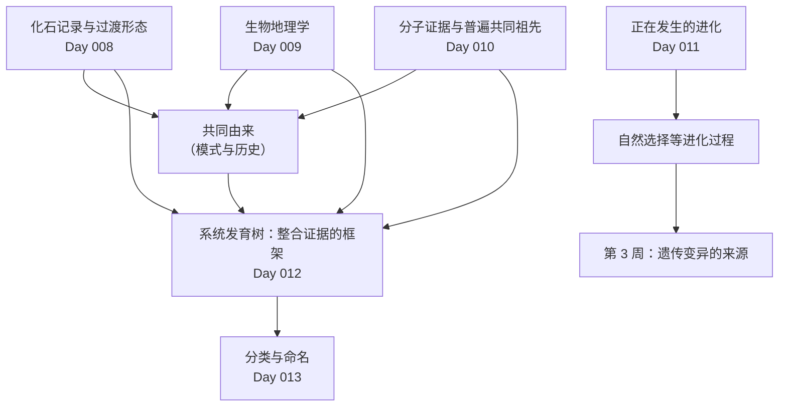

# Day 014 · 第 2 周复盘：进化的证据与树状思维

> **部分** 第一部分 概念基础与证据 ｜ **周次** 第 2 周 ｜ **发布日期** 2026-11-16 ｜ **建议用时** 约 90 分钟
> **本周讲次** Day 008 至 Day 013
> **精读文献** Theobald（2010a）

## 1 本周知识结构

本周围绕三个问题展开。第一，**有哪些相互独立的证据支持共同由来**：化石的时间顺序、生物的地理分布与分子数据各自给出可以失败的预测，而它们指向同一个历史。第二，**进化的过程能否被直接观察**：在达尔文雀、桦尺蛾、孔雀鱼与 HIV 中，研究者在数年到数十年内测量到了群体的遗传改变及其原因。第三，**如何阅读、使用与命名系统发育树**：树是整合上述证据的框架，正确读树与按谱系分类是后续各部分的基础。

---

## 2 核心结论

1. 放射性定年给出地层的绝对年龄。化石记录虽不完整，但由独立性状推断的系统发育与类群在地层中出现的顺序总体一致（Benton & Hitchin 1997）。过渡化石可以作为可检验的预测被发现（*Tiktaalik*），它们通常是兼具镶嵌特征的侧支，而不是直接祖先（Day 008）。
2. 生物的分布不能单用环境来解释，而反映了谱系历史与扩散限制（达尔文的"三大事实"）。替代分布与扩散可以用带有年代的系统发育来区分：几维鸟与象鸟的分化晚于两地陆块的分离，否定了平胸鸟分布的纯粹替代分布解释。华莱士线对应更新世陆架的地理格局；海洋岛的区系不平衡与特有性体现了扩散限制；岛屿上的物种数可以理解为迁入与灭绝的动态平衡（Day 009）。
3. 遗传密码的近乎普遍性、由不同蛋白质独立推断的树之间远高于随机预期的一致性（Penny et al. 1982），以及共享的假基因与逆转座子插入，共同支持共同由来。共享插入还独立证实了河马是鲸类现存最近的亲属（Day 010）。
4. 要确认"观察到了进化"，需要证明跨世代的变化、遗传基础与选择因子三者。达尔文雀表明进化在短期内可以用 $R = h^2 S$ 预测，但波动选择使长期进化难以预测；桦尺蛾案例的证据链已从频率变化延伸到捕食实验与致因突变；孔雀鱼引种实验测得 3700–45,000 darwin 的进化速率（Day 011）。
5. 进化速率随测量间隔的延长而降低（Gingerich 1983），因此当代速率与化石记录速率不能直接比较。病原体的耐药进化遵循同样的选择逻辑，联合用药的原理在于同时具备多种耐药突变的概率极低（Day 011）。
6. 亲缘关系取决于共同祖先的远近，而不取决于末端在图上的位置；节点旋转不改变树的含义。按末端顺序读出"阶梯"、把早分支谱系视为"原始"（原始谱系谬误）、把现生物种当作彼此的祖先，都是常见的读树错误（Day 012）。
7. 单系群包含一个祖先的全部后裔，只能由共有衍征来识别。分支系统学主张正式类群只应是单系群；系统发育命名用谱系关系定义名称，使名称的含义不随等级变动而改变（Day 012–013）。
8. 冠群、干群与全群的区分精确地描述了化石在树上的位置。干群化石记录了冠群特征的逐步拼合，因而"缺失环节"与"活化石"都应以树状思维重新表述；这一区分对化石校准与分子定年也至关重要（Day 013）。

---

## 3 公式与模型速查

| 模型或公式 | 表达式 | 主要假设 | 出处 |
|---|---|---|---|
| 放射性定年 | $t = \frac{1}{\lambda}\ln\left(1 + \frac{D}{P}\right)$，$\lambda = \frac{\ln 2}{t_{1/2}}$ | 体系封闭，矿物形成时不含子体同位素 | Day 008 |
| 种–面积关系 | $S = cA^{z}$ | 经验规律，$z$ 依类群与地区而异 | Day 009 |
| 岛屿平衡物种数 | $\hat S = \frac{I_0}{I_0 + E_0}P$，$\hat T = \frac{I_0 E_0}{I_0 + E_0}$ | 迁入率与灭绝率随物种数线性变化 | Day 009 |
| 趋近平衡 | $S(t) = \hat S\left[1 - e^{-(I_0 + E_0)t/P}\right]$ | 同上，从空岛出发 | Day 009 |
| 树的数目 | 无根 $(2n-5)!!$，有根 $(2n-3)!!$ | 完全分辨、末端带标签 | Day 010 |
| LTR 定年 | $t = \frac{d}{2\mu}$ | 两段 LTR 插入时相同，中性且速率恒定 | Day 010 |
| 育种者方程 | $R = h^{2}S$ | 加性遗传，一个世代的响应 | Day 011 |
| darwin 速率 | $r_{\mathrm{d}} = \frac{\ln \bar x_2 - \ln \bar x_1}{\Delta t}$ | $\Delta t$ 以百万年计 | Day 011 |
| haldane 速率 | $r_{\mathrm{h}} = \frac{(\bar y_2 - \bar y_1)/s_p}{g}$ | $\bar y$ 为对数转换后的平均值，$g$ 为世代数 | Day 011 |
| 对显性表型的选择 | $p' = \frac{p(1 - s)}{1 - s(1 - q^{2})}$ | 显性表型的相对适合度为 $1 - s$，随机交配 | Day 011 |
| 预存耐药变异体 | $N\mu^{k}$ | 各耐药突变相互独立 | Day 011 |
| 等价画法 | $2^{n-1}$ | 完全分辨的有根树 | Day 012 |
| 单系群数目 | $n - 1$ | 完全分辨的有根树，不计单个末端 | Day 013 |

---

## 4 综合练习

1. **（计算）** 某化石层下方火山灰中锆石的放射成因 ²⁰⁶Pb 与剩余 ²³⁸U 之比 $D/P = 0.045$，²³⁸U 半衰期取 $4.5 \times 10^{9}$ 年。(a) 计算火山灰的年龄。(b) 若该层中的类群 X 是类群 Y 的姐妹群，而 Y 已知最早的化石为 2.5 亿年前，Y 的幽灵谱系至少有多长？(c) 为什么用火山灰而不是化石本身定年？
2. **（计算）** 某岛屿的物种库 $P = 200$，$I_0 = 8$ 种/年，$E_0 = 2$ 种/年（数值为假设值）。(a) 求 $\hat S$、$\hat T$ 以及从空岛达到 $0.9\hat S$ 所需的时间。(b) 若生境面积减半，按种–面积关系（$z = 0.25$）预测长期将保留多少比例的物种？若迁入率不变，这相当于把 $E_0$ 提高到多少？(c) 为什么物种的丧失可能滞后于生境丧失？
3. **（计算与概念）** (a) 6 个物种的无根二叉树有多少种？若 5 个基因各自独立地随机给出一棵树，后 4 个基因都与第 1 个基因的树完全相同的概率是多少？11 个物种时又如何？(b) 实际研究中，不同基因的树往往并不完全相同。这是否削弱了 Penny 等（1982）的论证？至少给出两个导致基因树之间不一致的原因。
4. **（计算）** 某地雀群体的平均喙深为 9.0 mm，喙深的遗传力 $h^{2} = 0.7$。第 1 年干旱，选择差 $S = +0.6$ mm；第 2 年多雨，$S = -0.5$ mm（数值为假设值，每年一代）。(a) 计算两代后的平均喙深。(b) 分别以第 1 年的变化与两年的净变化计算以 darwin 为单位的速率。(c) 这一结果如何说明进化速率的时间尺度效应？
5. **（读树）** 有根树 `(((A,B),(C,(D,E))),F);`。(a) 下列哪些是单系群：{C, D, E}、{A, B, C}、{D, E}、{A, B, C, D, E}、{B, C}？(b) 这棵树有多少种等价画法？`(F,(((E,D),C),(B,A)));` 是否与它相同？`(((A,C),(B,(D,E))),F);` 呢？(c) 有人说："F 最先分出，所以 F 是这个类群中最原始的物种。"指出其错误。
6. **（冠群、干群与校准）** 某类群 X 的现生成员为 L1、L2，其现生姐妹群为 L3。化石 S（1.2 亿年前）位于 X 的干群，化石 C（9000 万年前）位于 X 的冠群。(a) 哪个化石可以为 X 冠群的最近共同祖先提供最小年龄？哪个化石可以为 X 全群与 L3 的分化提供最小年龄？分别是多少？(b) 若误把 S 当作冠群成员，会对冠群的定年造成什么影响？
7. **（综合）** 以平胸鸟为例，综合 Day 009、010、012 与 013 的内容回答：(a) 替代分布假说作出了哪些预测？哪些证据否定了它？(b) 不包括䳍类的"平胸鸟"是什么类型的类群？为什么 Harshman 等称其为"多系"？(c) 若要为"平胸鸟加䳍类"这一分支命名，写出一个节点定义与一个分支定义。
8. **（论述）** "进化只是一种理论，没有直接证据。"用本周至少四条相互独立的证据线反驳这一说法。对每一条证据，说明它作出了什么预测，以及什么样的观察将会否定共同由来。

答案要点

1. (a) $\lambda = \ln 2/(4.5\times10^{9}) \approx 1.540\times10^{-10}$ /年，$t = \ln(1.045)/\lambda \approx 2.858\times10^{8}$ 年，约 2.86 亿年。(b) 姊妹群起源于同一次分化，故 Y 的谱系至少在 2.86 亿年前就已存在，幽灵谱系至少约 3580 万年。(c) 化石所在的沉积岩通常无法直接用放射性方法定年，需测定上下层的火山岩等岩浆岩，从而给出化石年龄的范围（Day 008）。
2. (a) $\hat S = 200 \times 8/10 = 160$ 种，$\hat T = 8 \times 2/10 = 1.6$ 种/年，$t_{0.9} = 200\ln 10/10 \approx 46.1$ 年。(b) $0.5^{0.25} \approx 0.841$，即长期保留约 84%（约 134.5 种）；若 $I_0$ 不变，对应 $E_0 = P I_0/\hat S - I_0 \approx 3.89$ 种/年。(c) 物种数向新平衡的调整需要时间，其时间尺度约为 $P/(I_0 + E_0)$；在此期间，物种数高于新的平衡值。
3. (a) 6 个物种有 $(2\times6-5)!! = 105$ 种无根树，概率为 $(1/105)^{4} \approx 8.2\times10^{-9}$；11 个物种时为 $(1/34{,}459{,}425)^{4} \approx 7.1\times10^{-31}$。(b) 不削弱。Penny 等比较的是树间距离与随机预期，而不要求各树完全一致。基因树之间不一致的原因包括：采样与推断误差、不完全谱系分选（Day 046、120）、水平基因转移（Day 107）、旁系同源基因被误当作直系同源（Day 092），以及长枝吸引等系统误差（Day 114）。
4. (a) 第 1 年后为 $9.0 + 0.7\times0.6 = 9.42$ mm，第 2 年后为 $9.42 - 0.7\times0.5 = 9.07$ mm。(b) 第 1 年：$\ln(9.42/9.0)/10^{-6} \approx 45{,}600$ darwin；两年净变化：$\ln(9.07/9.0)/(2\times10^{-6}) \approx 3900$ darwin。(c) 方向相反的变化相互抵消，测量间隔越长，净变化相对越小，算得的速率就越低；化石记录中的长间隔速率因此远低于当代的短间隔速率（Gingerich 1983）。
5. (a) {C, D, E}、{D, E}、{A, B, C, D, E} 是单系群；{A, B, C} 与 {B, C} 不是（代码验算）。(b) 5 个内部节点，共 $2^{5} = 32$ 种等价画法；`(F,(((E,D),C),(B,A)));` 只是旋转了若干节点，与原树相同；`(((A,C),(B,(D,E))),F);` 把 A 与 C 归为姐妹群，是不同的树。(c) F 与其余五个物种组成的分支互为姐妹群，两者一样古老；F 可能保留某些祖征，也必然有自己的衍征，"原始"只能针对具体性状而言（原始谱系谬误，Day 012）。
6. (a) 化石 C 为冠群最近共同祖先提供最小年龄 9000 万年；X 全群与 L3 的分化至少早于 X 全群中最早的化石，即化石 S，最小年龄为 1.2 亿年。(b) 冠群的最小年龄会被错误地推到 1.2 亿年前，比证据所支持的早 3000 万年；在分子定年中，这会使冠群及其内部各节点的年龄估计系统性偏老。
7. (a) 替代分布假说预测：平胸鸟各谱系的分化顺序与年代应对应冈瓦纳各陆块分离的顺序与年代；不能飞的祖先只能被动分隔。否定它的证据：能飞的䳍类位于平胸鸟内部，飞行能力至少独立丧失三次（Harshman et al. 2008）；象鸟与几维鸟互为姊妹群，且其分化晚于两地陆块的分离（Mitchell et al. 2014）。这些结果支持祖先能够飞行、经扩散到达各陆块。(b) 若平胸鸟与䳍类合起来构成一个单系群，按成员组成，不含䳍类的"平胸鸟"是并系群；由于"不能飞行"是多次独立获得的趋同性状，其最近共同祖先很可能能够飞行，以该性状定义的类群被称为多系（Day 012）。(c) 节点定义示例："鸵鸟与䳍类（例如某个特定的䳍类物种）的最近共同祖先及其全部后裔"；分支定义示例："鸵鸟以及所有与鸵鸟的共同祖先比与鸡的共同祖先更晚的生物"（以鸡这一非古颚类鸟类作为外部参照）。注意，定义所选的参照类群决定了名称的稳定性。
8. 要点示例：(1) 化石：预测类群在地层中出现的顺序与由独立性状推断的系统发育一致；若大量化石出现在与系统发育严重矛盾的地层中，共同由来将受到挑战（Day 008）。(2) 生物地理：预测海洋岛的生物与最近的大陆近缘、扩散能力弱的类群缺失；若环境相似的岛屿普遍拥有与最近大陆无关的区系，或缺失的类群与扩散能力无关，将构成反证（Day 009）。(3) 分子：预测不同基因独立推断的树高度一致、共享插入呈嵌套分布；若各基因给出彼此无关的树，或共享插入的分布与其他证据普遍冲突，将构成反证（Day 010）。(4) 直接观测：预测可遗传变异在选择下会在世代之间改变频率，且变化方向与选择方向一致；若长期选择下可遗传性状毫无响应，将削弱自然选择的解释（Day 011）。每一条证据都可能失败，而它们相互独立却指向同一个历史，这正是共同由来被普遍接受的原因。"理论"在科学中指得到广泛证据支持、能够解释大量现象的系统解释，而不是"猜测"。

---

## 5 文献精读：Theobald（2010a）

**出处与背景.** 本文发表于 *Nature* 第 465 卷（2010），作者为 Brandeis 大学的 Douglas Theobald。普遍共同祖先（UCA）是进化理论的核心命题之一，支持它的证据（如遗传密码的普遍性，Day 010）大多是定性的。在三个域的尺度上，水平基因转移十分常见，而传统的分析往往预设"序列相似意味着同源"，这使"所有生命源于同一祖先"本身难以被检验。

**研究问题.** 能否在不预设"序列相似即共同由来"的前提下，用统计方法比较 UCA 与"多个独立起源"等竞争假说？

**方法.** 作者选取 23 种普遍保守的蛋白质，涵盖细菌、古菌与真核生物各 4 个物种，共 12 个物种；分别用系统发育模型拟合 UCA 模型（所有序列由一棵树连接）与独立起源（IO）模型（不同类群由不同的树分别描述），并用似然比检验、赤池信息量准则（AIC）与贝叶斯因子进行模型比较。

**主要结果.** UCA 模型得到压倒性的支持；作者认为，即使考虑水平基因转移或生命的多次起源，这一结论依然成立。据 Brandeis 大学的报道，UCA 相对于次优模型的支持程度至少为 $10^{2860}$ 比 1（Brandeis University 2010）。

**争论.**
- Koonin 与 Wolf（2010）用不含系统发育结构的人工比对进行模拟，发现该检验仍然偏好 UCA，认为这一偏好只是序列显著相似的平凡结果；他们认为对 UCA 的形式证明尚未实现，在原则上也可能无法实现，但比较基因组学为 UCA 提供的证据是充分的。
- Yonezawa 与 Hasegawa（2010）指出，把两个并不同源的线粒体基因（*cytb* 与 *nd2*）按同一读码框比对后，该检验同样偏好共同祖先。Theobald（2010b）答复说，遗传密码的约束本身会在这类序列之间诱导出并非源于共同祖先的相关；按原设计使用密码子或蛋白质模型时，检验的表现符合预期。
- Theobald（2011）进一步论证，基于模型的检验以似然与贝叶斯概率理论为基础，不同于以 P 值为基础的序列相似性检验；在 Koonin 与 Wolf 的人工数据中，序列相似性是影响检验偏好的主要因素。
- de Oliveira Martins 与 Posada（2014）的模拟表明，该检验所依赖的固定比对会使结果偏向 UCA：在 Theobald 所描述的条件下，检验的假阳性率达到 100%。他们还指出原始分析存在选择偏差，因为所用序列事先经过了相似性搜索与比对优化。

**评价.**
- *贡献*：把一个核心而又常被视为不言自明的命题转化为可以统计比较的竞争模型，并引发了关于如何检验深层同源性的方法论讨论。
- *局限*：结论依赖于预先选定并比对的保守蛋白质，比对本身可能把"相似"带入检验；所采样的物种数很少；"独立起源"模型的设定是否恰当仍有争议。
- *启示*：普遍共同祖先的可信度并不取决于某一个"形式证明"，而来自多条相互独立的证据线的一致（Day 010）。这场争论也说明，统计检验的结论离不开对数据如何产生、如何被筛选的仔细审视。

**讨论题.**
1. 为什么"不预设序列相似即同源"对这项检验至关重要？Koonin 与 Wolf 的模拟如何挑战了这一点？
2. 按 de Oliveira Martins 与 Posada 的批评，序列的预先筛选与比对为什么会使检验偏向 UCA？你会如何设计一个避免这一偏差的检验？
3. 如果普遍共同祖先无法被"形式证明"，这是否意味着它缺乏科学依据？结合本周的各条证据线讨论。

---

## 6 自测清单

- [ ] 我能用放射性定年公式计算岩石年龄，并解释幽灵谱系的含义。
- [ ] 我能说明化石记录不完整却仍能检验系统发育的理由。
- [ ] 我能用带有年代的系统发育区分替代分布与扩散。
- [ ] 我能推导岛屿生物地理学平衡模型的平衡物种数与周转速率。
- [ ] 我能解释共享假基因与逆转座子插入为何是共同由来的有力证据。
- [ ] 我能区分"观察到了选择"与"观察到了进化"，并用育种者方程预测选择响应。
- [ ] 我能计算 darwin 与 haldane 单位的进化速率，并解释时间尺度效应。
- [ ] 我能正确读树，判别单系群、并系群与多系群，并识别原始谱系谬误。
- [ ] 我能区分冠群、干群与全群，并为一个分支写出节点定义与分支定义。

---

## 参考文献

- Benton, M. J., & Hitchin, R. (1997). Congruence between phylogenetic and stratigraphic data on the history of life. *Proceedings of the Royal Society of London. Series B: Biological Sciences, 264*, 885–890. https://doi.org/10.1098/rspb.1997.0123 ［[PMC 全文](https://pmc.ncbi.nlm.nih.gov/articles/PMC1688444)］
- de Oliveira Martins, L., & Posada, D. (2014). Testing for universal common ancestry. *Systematic Biology, 63*(5), 838–842. https://doi.org/10.1093/sysbio/syu041 ［[PMC 全文](https://pmc.ncbi.nlm.nih.gov/articles/PMC5215821)］
- Gingerich, P. D. (1983). Rates of evolution: Effects of time and temporal scaling. *Science, 222*, 159–161.（DOI 未核实）
- Harshman, J., Braun, E. L., Braun, M. J., Huddleston, C. J., Bowie, R. C. K., Chojnowski, J. L., Hackett, S. J., Han, K.-L., Kimball, R. T., Marks, B. D., Miglia, K. J., Moore, W. S., Reddy, S., Sheldon, F. H., Steadman, D. W., Steppan, S. J., Witt, C. C., & Yuri, T. (2008). Phylogenomic evidence for multiple losses of flight in ratite birds. *Proceedings of the National Academy of Sciences of the United States of America, 105*(36), 13462–13467. https://doi.org/10.1073/pnas.0803242105
- Koonin, E. V., & Wolf, Y. I. (2010). The common ancestry of life. *Biology Direct, 5*, 64. https://doi.org/10.1186/1745-6150-5-64 ［[PMC 全文](https://pmc.ncbi.nlm.nih.gov/articles/PMC2993666)］
- Mitchell, K. J., Llamas, B., Soubrier, J., Rawlence, N. J., Worthy, T. H., Wood, J., Lee, M. S. Y., & Cooper, A. (2014). Ancient DNA reveals elephant birds and kiwi are sister taxa and clarifies ratite bird evolution. *Science, 344*(6186), 898–900. https://doi.org/10.1126/science.1251981
- Penny, D., Foulds, L. R., & Hendy, M. D. (1982). Testing the theory of evolution by comparing phylogenetic trees constructed from five different protein sequences. *Nature, 297*(5863), 197–200. https://doi.org/10.1038/297197a0
- Theobald, D. L. (2010a). A formal test of the theory of universal common ancestry. *Nature, 465*(7295), 219–222. https://doi.org/10.1038/nature09014
- Theobald, D. L. (2010b). Theobald reply. *Nature, 468*(7326), E10. https://doi.org/10.1038/nature09483
- Theobald, D. L. (2011). On universal common ancestry, sequence similarity, and phylogenetic structure: The sins of P-values and the virtues of Bayesian evidence. *Biology Direct, 6*, 60. https://doi.org/10.1186/1745-6150-6-60 ［[PMC 全文](https://pmc.ncbi.nlm.nih.gov/articles/PMC3314578)］
- Yonezawa, T., & Hasegawa, M. (2010). Was the universal common ancestry proved? *Nature, 468*(7326), E9. https://doi.org/10.1038/nature09482

**网络资源**（访问日期 2026-11-16）

- Brandeis University. (2010). *Shaking the family tree*. Brandeis Magazine. https://www.brandeis.edu/magazine/2010/fall/inquiry/familytree.html

本周其余文献见 Day 008–013 各讲的参考文献，汇总于 [references.bib](../../references.bib)。

---

**下周预告** 第 3 周 · 遗传变异的来源（[Day 015：遗传学回顾：孟德尔遗传、连锁与重组](../week03/day015-mendel-linkage-recombination.md)）
