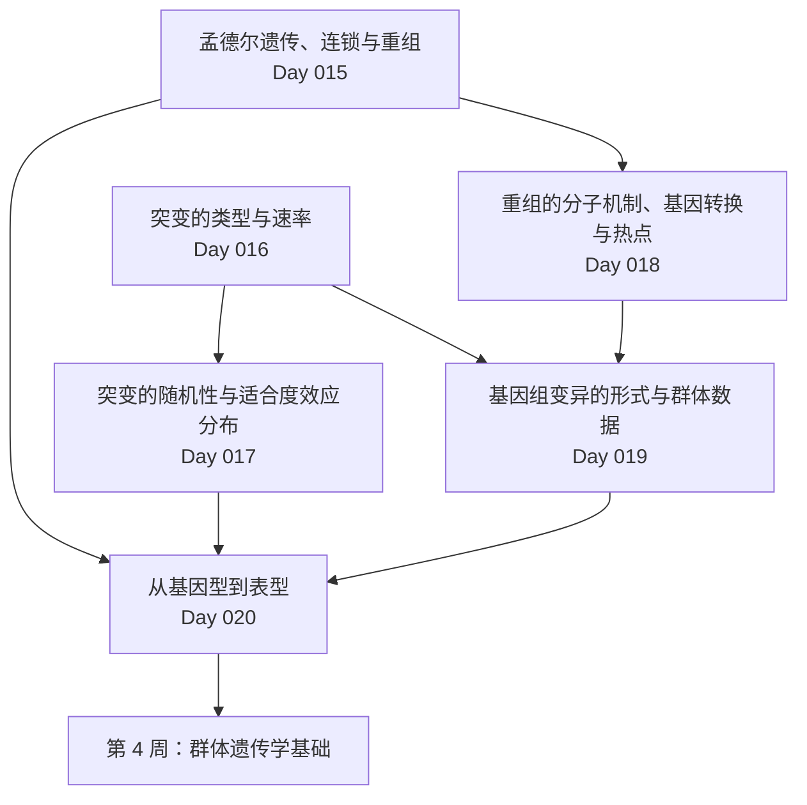

# Day 021 · 第 3 周复盘：遗传变异的来源

> **部分** 第一部分 概念基础与证据 ｜ **周次** 第 3 周 ｜ **发布日期** 2026-11-23 ｜ **建议用时** 约 90 分钟
> **本周讲次** Day 015 至 Day 020
> **精读文献** Luria & Delbrück（1943）

## 1 本周知识结构

本周围绕三个问题展开。第一，**可遗传变异从何而来**：突变产生新的等位基因，其速率、类型与对适合度的效应各有规律；重组与基因转换则在已有变异之间产生新的组合。第二，**变异以什么形式存在、如何被测量**：从单碱基变异到结构变异，从测序读段到基因型与单倍型，测量本身也会带来系统误差。第三，**基因型变异如何转化为表型变异**：显性、上位性、多效性与可塑性决定了哪些遗传差异能被选择"看到"。下一周将以这些变异为对象，建立群体遗传学的基本模型。

---

## 2 核心结论

1. 孟德尔的分离律与自由组合律源于减数分裂中染色体的行为。同一染色体上的基因相互连锁，重组率 $r$ 介于 0 与 0.5 之间，可以作为遗传图距的度量；多次交换使重组率低估图距，Haldane 作图函数在假定无干涉的条件下对此进行校正（Haldane 1919）。在随机交配的大群体中，重组使位点之间的关联每代按 $(1 - r)$ 的比例衰减（Day 015）。
2. 突变包括点突变、indel 与结构变异。人类每位点每代的突变率约为 $1.2 \times 10^{-8}$，子女的新生突变数随父亲年龄增加，父亲年龄每增加一岁约增加两个（Kong et al. 2012）。突变率本身也是可以进化的性状，漂变障碍假说用遗传漂变对选择的限制来解释物种间突变率的差异（Lynch et al. 2016）（Day 016）。
3. 波动检验与影印平板实验表明，细菌的抗性突变在接触选择因子之前就已随机产生（Luria & Delbrück 1943；Lederberg & Lederberg 1952）。"随机"是指突变的发生与它是否有利无关，并不意味着各位点、各类型的突变概率相同；突变偏向是否具有适应意义仍有争议（Monroe et al. 2022；Liu & Zhang 2022；Wang et al. 2023）（Day 017）。
4. 新突变对适合度的影响构成一个分布，大多数新突变有害或近乎中性；$\lvert N_e s \rvert \ll 1$ 的突变的命运主要由漂变决定，因此同一个突变在小群体中可能是有效中性的，在大群体中却受到选择（Eyre-Walker & Keightley 2007）（Day 017）。
5. 减数分裂重组始于程序性双链断裂，断裂远多于交叉，交叉受到交叉保证、干涉与稳态的调控。基因转换在短距离上打乱位点间的组合，其 GC 偏向在群体层面等价于加性选择（Duret & Galtier 2009）。人类与小鼠的重组热点由 PRDM9 决定（Baudat et al. 2010；Myers et al. 2010）；热点因转换而自我毁灭（Boulton et al. 1997），PRDM9 的快速进化则使热点不断更替（Day 018）。
6. 以数目计，个体之间的差异 99.9% 以上是 SNV 与短 indel；以碱基计，结构变异的贡献更大（1000 Genomes Project Consortium 2015）。基因型由测序读段推断而来，带有不确定性；VCF 记录变异与基因型，定相恢复单倍型；以单一参考基因组为坐标会造成参考偏倚，泛基因组参考可以检出更多结构变异（Liao et al. 2023）（Day 019）。
7. 基因型–表型图谱通常是多对一、非线性且依赖环境的。功能缺失突变常为隐性，可由通量对酶量的收益递减解释（Kacser & Burns 1981）；上位性有功能、组成与统计三种含义，其大小依赖于度量尺度（Phillips 2008）；多效性在不同研究问题中含义不同（Paaby & Rockman 2013）；存在基因型 × 环境互作时，方差分解只适用于特定的环境范围（Lewontin 1974），而跨环境遗传相关不等于 ±1 时可塑性可以进化（Via & Lande 1985）（Day 020）。

---

## 3 公式与模型速查

| 模型或公式 | 表达式 | 主要假设 | 出处 |
|---|---|---|---|
| Haldane 作图函数 | $r = \frac{1}{2}\left(1 - e^{-2d}\right)$ | 交换沿染色体为泊松过程，无干涉 | Day 015 |
| Kosambi 作图函数 | $r = \frac{1}{2}\tanh(2d)$ | 推导中考虑了干涉 | Day 018 |
| 并发系数与干涉 | $c$ = 观察双交换数 ÷ 期望双交换数，$I = 1 - c$ | 期望值按两区段独立计算 | Day 015 |
| 连锁不平衡的衰减 | $D_t = D_0(1 - r)^{t}$ | 随机交配的大群体 | Day 015 |
| 新生突变数 | $E[n_{\mathrm{dn}}] = 2\mu G$ | 二倍体，$G$ 为单倍体基因组长度 | Day 016 |
| 零类法 | $m = -\ln p_0$，$\mu \approx m/N_t$ | 每个培养中的突变事件数服从泊松分布 | Day 017 |
| 均值法 | $\bar r = m\ln(mC)$ | Luria–Delbrück 模型，$C$ 为平行培养数 | Day 021 |
| Bateman–Mukai | $U \ge (\Delta M)^{2}/\Delta V$，$\bar s \le \Delta V/\Delta M$ | 各突变效应相等时取等号 | Day 017 |
| 有效中性 | $\lvert N_e s \rvert \ll 1$ | — | Day 017 |
| 偏向基因转换 | $b = c(2\pi - 1)/2$，$\Delta p = bpq$ | 随机交配，无选择与漂变 | Day 018 |
| 转换片段分开两位点 | $P_{\mathrm{GC}}(x) = 2gL\left(1 - e^{-x/L}\right)$ | 片段长度服从指数分布 | Day 018 |
| 定相的可能组合 | $2^{k-1}$ | $k$ 个杂合位点，未定相 | Day 019 |
| 加性上位系数 | $\varepsilon = W_{AB} - W_{Ab} - W_{aB} + W_{ab}$ | 乘性尺度上对各值取对数 | Day 020 |
| 通量示意模型 | $J = e/(e + K)$，$h = 1 - J(0.5)/J(1)$ | 收益递减的示意曲线 | Day 020 |
| 表型的线性分解 | $P = G + E + (G \times E)$ | 线性模型 | Day 020 |

---

## 4 综合练习

1. **（计算）** 对三重杂合子 *abc*/+++ 进行测交，1000 个后代的表型为：*abc* 413，+++ 405，*a*++ 42，+*bc* 48，*ab*+ 44，++*c* 44，*a*+*c* 2，+*b*+ 2（本题数据为假设）。(a) 判断三个基因的顺序。(b) 计算相邻区段的重组率、并发系数与干涉。(c) 直接由两端基因计算的重组率是多少？分别用 Haldane 与 Kosambi 作图函数把它换算为图距，哪一个更接近两个区段之和？为什么？
2. **（计算）** 某子女携带 60 个新生突变，可检测的单倍体基因组长度为 $2.5 \times 10^{9}$ bp（本题数据为假设）。(a) 估计每位点每代突变率。(b) 在 10,000 个二倍体个体组成的群体中，每代共产生多少个新突变？某一特定位点在每代中至少于某个个体中发生突变的概率约为多少？(c) 按每年约增加两个新生突变计算，父亲 40 岁时出生的子女比 20 岁时出生的子女约多携带多少个新生突变？
3. **（推导与计算）** 按第 5 节的模型：(a) 推导 $\bar r = m\ln(mC)$，并说明 $t_0$ 的含义。(b) Luria 与 Delbrück 的实验 16 中，20 个独立培养的抗性菌数均值为 11.3、方差为 694，其中 11 个培养没有抗性菌；从同一大培养中取出的样品（实验 10a）均值为 16.7、方差为 15。计算两组数据的方差均值比，并说明其含义。(c) 分别用零类法与均值法估计实验 16 中每个培养的平均突变事件数 $m$，并解释两种估计为何相差悬殊。
4. **（计算）** 人类非交叉基因转换约 68% 传递 GC 等位基因（Williams et al. 2015），取 $\pi = 0.68$。(a) 设一个普通位点在杂合子的每次减数分裂中落入转换片段的概率 $c = 10^{-5}$，一个热点内的位点 $c = 10^{-3}$（本题参数为假设），分别计算 $b$ 与 $N_e b$（$N_e = 10^{4}$）。(b) 结合 Day 017 的"有效中性"概念，说明为什么 GC 含量与局部重组率相关。
5. **（计算）** 某位点在 100 个个体中的基因型为 0/0：49，0/1：42，1/1：9。(a) 计算 ALT 等位基因频率、观察杂合度与期望杂合度 $2pq$。(b) 若由于测序深度低与参考偏倚，10% 的真实杂合子被判为 0/0，重新计算上述各量。(c) 结果中出现了怎样的"杂合子缺失"？这对 Day 023 中用杂合子缺失推断近交意味着什么？
6. **（计算与概念）** 两个基因 *A* 与 *B* 位于同一条色素合成途径上，任一基因纯合缺失都使花呈白色。(a) 双杂合子自交后代中紫花与白花的比例是多少？(b) 某次自交得到紫花 170 株、白花 150 株（本题数据为假设），用卡方检验判断数据是否符合 (a) 的比例。(c) 这是哪一种意义上的上位性？若在一个群体中 *a* 与 *b* 都很稀有，统计上位方差会很大吗？
7. **（概念）** 判断并纠正：(a)"Luria–Delbrück 实验证明了环境不能影响突变的发生。"(b)"无偏的基因转换不改变等位基因频率，因此没有进化后果。"(c)"结构变异的数目远少于 SNV，所以对个体之间序列差异的贡献很小。"(d)"PKU 患者的表型由基因型决定，与环境无关。"
8. **（论述）** 以一个新出现的人类点突变为例，说明它从产生、传递到可能影响表型并受到选择的过程中，本周各讲的概念分别在哪个环节起作用：突变率与父龄效应、突变的随机性与 DFE、重组与基因转换、变异的测量，以及基因型–表型图谱与基因型 × 环境互作。

答案要点

1. (a) 最少的两类 *a*+*c* 与 +*b*+ 为双交换类，与亲本型相比只有 *b* 改变了组合，故 *b* 居中，顺序为 *a*–*b*–*c*。(b) $r_{ab} = (42 + 48 + 4)/1000 = 0.094$，$r_{bc} = (44 + 44 + 4)/1000 = 0.092$；期望双交换数 $0.094 \times 0.092 \times 1000 \approx 8.65$，观察 4，$c \approx 0.46$，$I \approx 0.54$（代码验算）。(c) 直接计算 $r_{ac} = 0.178$，低于两区段之和 0.186，因为双交换在两端基因上恢复了亲本组合。Haldane 图距约 22.0 cM，Kosambi 图距约 18.6 cM，后者更接近两区段之和 18.6 cM；本例存在明显的正干涉，而 Haldane 函数假定无干涉，过度校正了多次交换（Day 015、Day 018）。
2. (a) $\mu = 60/(2 \times 2.5 \times 10^{9}) = 1.2 \times 10^{-8}$。(b) 每代约 $60 \times 10^{4} = 6 \times 10^{5}$ 个新突变；某一位点每代在群体中至少发生一次突变的概率约为 $2N\mu = 2.4 \times 10^{-4}$，即平均约 4200 代一次（代码验算）。(c) 约多 40 个（Kong et al. 2012；Day 016）。
3. (a) 设 $N(t) = N_0 e^{t}$，突变以速率 $a$ 发生，$t$ 时刻之前在 $\tau$ 时刻产生的突变到 $t$ 时刻形成 $e^{t - \tau}$ 个抗性菌，故 $E[r] = \int_{t_0}^{t} aN_0 e^{\tau} e^{t - \tau}\,d\tau = aN_t(t - t_0)$。$t_0$ 是在全部 $C$ 个培养中预期出现第一次突变的时刻，满足 $aCN_{t_0} = 1$，于是 $t - t_0 = \ln(aCN_t)$；记 $m = aN_t$，得 $\bar r = m\ln(mC)$。(b) 独立培养：$694/11.3 \approx 61$；同一大培养的样品：$15/16.7 \approx 0.9$。后者符合泊松抽样，前者远超泊松预期，说明独立培养之间存在突变发生时间造成的巨大波动，支持突变假说（Luria & Delbrück 1943）。(c) 零类法：$m = -\ln(11/20) \approx 0.60$；均值法：解 $m\ln(20m) = 11.3$ 得 $m \approx 2.8$（代码验算）。均值受少数"大奖"培养的强烈影响，而 Luria–Delbrück 分布的尾部很重，样本均值很不稳定；均值法因此有偏，零类法只用无突变体的培养，在 $m$ 较小时更可靠（Rosche & Foster 2000）。
4. (a) $2\pi - 1 = 0.36$。普通位点：$b = 1.8 \times 10^{-6}$，$N_e b = 0.018$；热点位点：$b = 1.8 \times 10^{-4}$，$N_e b = 1.8$（代码验算）。(b) GC 偏向基因转换的效应类似于选择系数为 $b$ 的加性选择，而 $b$ 与局部的转换（重组）频率成正比：在低重组区它近乎"有效中性"，在高重组区则足以系统地推高 GC 等位基因的频率，于是 GC 含量与局部重组率相关（Duret & Galtier 2009；Day 018）。
5. (a) $p_{\mathrm{ALT}} = (42 + 2 \times 9)/200 = 0.30$，观察杂合度 0.42，期望杂合度 $2 \times 0.3 \times 0.7 = 0.42$，二者相等。(b) 被误判的杂合子约 4.2 个，期望计数变为 53.2、37.8、9；$p_{\mathrm{ALT}} \approx 0.279$，观察杂合度 0.378，期望杂合度约 0.402（代码验算）。(c) 观察杂合度低于期望，$1 - H_o/H_e \approx 0.06$，看似近交造成的杂合子缺失，实为技术误差；用杂合子缺失推断近交或群体结构时，必须先排除基因型判定误差与参考偏倚（Day 019、Day 023）。
6. (a) 只有 *A_B_* 为紫花，比例为 9 紫 : 7 白。(b) 期望 180 与 140，$\chi^{2} \approx 1.27$，自由度 1，$P \approx 0.26$（代码验算），不能拒绝 9:7。(c) 这是组成上位性：一个位点的纯合缺失遮盖了另一个位点的效应。统计上位方差取决于等位基因频率：若 *a* 与 *b* 都很稀有，几乎所有个体都同时携带 *A* 与 *B*，相互作用很少表现出来，统计上位方差也就很小（Phillips 2008；Day 020）。
7. (a) 错误。该实验表明抗噬菌体突变在接触噬菌体之前就已产生，而不是由噬菌体诱导的；它并不排除环境（如诱变剂或胁迫）提高突变率，也不排除不同位点的突变率存在偏向（Day 017）。(b) 错误。无偏的基因转换虽然平均而言不改变频率，却会在短距离上打乱位点之间的组合，影响连锁不平衡；有偏的转换则像选择一样改变频率（Day 018）。(c) 错误。按碱基计，结构变异影响的序列多于 SNV 与短 indel（1000 Genomes Project Consortium 2015）。(d) 错误。新生儿筛查与早期饮食治疗可以使患儿正常发育，PKU 基因型的表型取决于饮食环境（Day 020）。
8. 要点示例：(1) 产生：突变率决定新突变的输入量，父源突变随父亲年龄增加，突变谱与突变率在基因组中并不均匀（Day 016）。(2) 随机性：突变的发生与其效应无关，但它一出现就从 DFE 中"抽取"一个效应值，大多有害或近中性，$N_e s$ 决定其命运主要由选择还是漂变左右（Day 017）。(3) 传递：突变所在的单倍型随重组被拆分，基因转换可能把它复制到同源染色体上，若存在 GC 偏向还会影响其传递比例（Day 018）。(4) 测量：要研究它，需要从测序数据中可靠地检出并定相，低深度与参考偏倚可能使其频率被低估（Day 019）。(5) 表型：它是否影响表型取决于显隐性、遗传背景（上位性）、可能的多效作用以及环境，只有表现为表型差异并影响适合度的部分才会被选择"看到"（Day 020）。

---

## 5 文献精读：Luria & Delbrück（1943）

**出处与背景.** 本文发表于 *Genetics* 第 28 卷（1943）。细菌接触噬菌体后，总会出现少数抗性菌；问题在于，这些抗性是接触噬菌体时被诱导产生的，还是此前已由随机突变产生（Day 017）。作者使用大肠杆菌 B 品系与当时称为 α 的噬菌体（后称 T1）。

**研究问题.** 两种假说对平行培养中抗性菌数的分布作出了不同的预测，能否据此在二者之间作出判别？

**数学.** 若抗性是在接触噬菌体时以很小的概率 $p$ 独立地被诱导出来，一个含 $N_t$ 个细胞的培养中抗性菌数近似服从均值为 $N_t p$ 的泊松分布，方差约等于均值。若抗性源于生长过程中的突变，设细胞数按 $N(t) = N_0 e^{t}$ 增长，突变以速率 $a$ 发生，则每个培养中突变事件数服从均值 $m = a(N_t - N_0) \approx aN_t$ 的泊松分布，没有突变体的培养所占比例为 $p_0 = e^{-m}$；在 $\tau$ 时刻发生的突变到 $t$ 时刻已扩增为 $e^{t - \tau}$ 个抗性菌，早期发生的突变会产生大量抗性菌（"大奖"培养）。由此得到抗性菌数的期望

$$\bar r = m\ln(mC),$$

其中 $C$ 为平行培养数（Luria & Delbrück 1943；Rosche & Foster 2000）。突变发生时间的随机性使方差远大于均值，这正是"波动检验"的名称来源。

**主要结果.** 独立培养之间的抗性菌数波动极大：在实验 16 中，20 个培养的均值为 11.3、方差为 694；而从同一大培养中取出的样品之间只有抽样误差，在实验 10a 中均值为 16.7、方差为 15（Luria & Delbrück 1943；练习 3）。这一对比支持突变假说。

**评价.**
- *贡献*：用分布的形状而非平均值来区分两种机制，把一个看似无法直接观察的问题转化为可以检验的统计预测；同时提供了估计突变率的方法。
- *局限与假设*：模型假定细胞按确定性的指数增长、突变体与非突变体的生长速率相同、不发生回复突变、抗性菌在平板上全部被检出。均值法受"大奖"培养影响而有偏；后来的方法中，零类法适用于突变率较低的情形，最大似然法在各种突变率下都表现最好（Rosche & Foster 2000）。此外，该研究只涉及一个细菌品系与一种噬菌体，结论的推广需要谨慎（Greenspan & Kukan 2024）。
- *后续*：Lederberg 与 Lederberg（1952）的影印平板实验以不依赖统计推断的方式证实了同一结论（Day 017）。需要注意的是，该实验表明的是抗性突变先于选择而存在，并不意味着环境对突变率毫无影响。

**讨论题.**
1. 为什么"方差远大于均值"比"均值的大小"更能区分两种假说？
2. 如果突变体的生长速率低于非突变体，抗性菌数的分布会如何改变？对突变率的估计有何影响？
3. 波动检验的逻辑能否用于检验其他"适应是否由环境诱导"的问题？试举一例并说明需要满足哪些条件。

---

## 6 自测清单

- [ ] 我能由三点测交数据确定基因顺序，计算图距、并发系数与干涉，并在 Haldane 与 Kosambi 作图函数之间换算。
- [ ] 我能由亲子三联体数据估计突变率，并解释父龄效应的含义。
- [ ] 我能推导波动检验中两种假说的预测，并用零类法估计突变率。
- [ ] 我能准确表述"突变是随机的"的含义，并说明适合度效应分布与有效中性的关系。
- [ ] 我能描述减数分裂重组的分子过程，解释基因转换的群体效应与热点转换悖论。
- [ ] 我能比较各类变异在数目与碱基数上的贡献，读懂 VCF 中的基因型，并说明参考偏倚的来源。
- [ ] 我能区分显性、上位性与多效性的不同含义，并用反应规范描述基因型 × 环境互作。

---

## 参考文献

- 1000 Genomes Project Consortium. (2015). A global reference for human genetic variation. *Nature, 526*(7571), 68–74. https://doi.org/10.1038/nature15393 ［[PMC 全文](https://pmc.ncbi.nlm.nih.gov/articles/PMC4750478)］
- Baudat, F., Buard, J., Grey, C., Fledel-Alon, A., Ober, C., Przeworski, M., Coop, G., & de Massy, B. (2010). PRDM9 is a major determinant of meiotic recombination hotspots in humans and mice. *Science, 327*(5967), 836–840. https://doi.org/10.1126/science.1183439 ［[PMC 全文](https://pmc.ncbi.nlm.nih.gov/articles/PMC4295902)］
- Boulton, A., Myers, R. S., & Redfield, R. J. (1997). The hotspot conversion paradox and the evolution of meiotic recombination. *Proceedings of the National Academy of Sciences of the United States of America, 94*(15), 8058–8063.（DOI 未核实）［[PMC 全文](https://pmc.ncbi.nlm.nih.gov/articles/PMC21556)］
- Duret, L., & Galtier, N. (2009). Biased gene conversion and the evolution of mammalian genomic landscapes. *Annual Review of Genomics and Human Genetics, 10*, 285–311. https://doi.org/10.1146/annurev-genom-082908-150001
- Eyre-Walker, A., & Keightley, P. D. (2007). The distribution of fitness effects of new mutations. *Nature Reviews Genetics, 8*(8), 610–618. https://doi.org/10.1038/nrg2146
- Greenspan, N. S., & Kukan, E. N. (2024). Historical highlight: The Luria-Delbrück fluctuation test – A study of the nature of bacterial mutations conferring resistance to infection by bacteriophage. *Pathogens and Immunity, 10*(1), 12–18. https://doi.org/10.20411/pai.v10i1.763 ［[PMC 全文](https://pmc.ncbi.nlm.nih.gov/articles/PMC11495157)］
- Haldane, J. B. S. (1919). The combination of linkage values, and the calculation of distances between the loci of linked factors. *Journal of Genetics, 8*, 299–309.（DOI 未核实）
- Kacser, H., & Burns, J. A. (1981). The molecular basis of dominance. *Genetics, 97*(3–4), 639–666. https://doi.org/10.1093/genetics/97.3-4.639 ［[PMC 全文](https://pmc.ncbi.nlm.nih.gov/articles/PMC1214416)］
- Kong, A., Frigge, M. L., Masson, G., Besenbacher, S., Sulem, P., Magnusson, G., Gudjonsson, S. A., Sigurdsson, A., Jonasdottir, A., Jonasdottir, A., Wong, W. S. W., Sigurdsson, G., Walters, G. B., Steinberg, S., Helgason, H., Thorleifsson, G., Gudbjartsson, D. F., Helgason, A., Magnusson, O. T., … Stefansson, K. (2012). Rate of de novo mutations and the importance of father's age to disease risk. *Nature, 488*(7412), 471–475. https://doi.org/10.1038/nature11396
- Lederberg, J., & Lederberg, E. M. (1952). Replica plating and indirect selection of bacterial mutants. *Journal of Bacteriology, 63*(3), 399–406. https://doi.org/10.1128/jb.63.3.399-406.1952 ［[PMC 全文](https://pmc.ncbi.nlm.nih.gov/articles/PMC169282)］
- Lewontin, R. C. (1974). The analysis of variance and the analysis of causes. *American Journal of Human Genetics, 26*(3), 400–411.（DOI 未核实）［[PMC 全文](https://pmc.ncbi.nlm.nih.gov/articles/PMC1762622)］
- Liao, W.-W., Asri, M., Ebler, J., Doerr, D., Haukness, M., Hickey, G., Lu, S., Lucas, J. K., Monlong, J., Abel, H. J., Buonaiuto, S., Chang, X. H., Cheng, H., Chu, J., Colonna, V., Eizenga, J. M., Feng, X., Fischer, C., Fulton, R. S., … Paten, B. (2023). A draft human pangenome reference. *Nature, 617*(7960), 312–324. https://doi.org/10.1038/s41586-023-05896-x ［[PMC 全文](https://pmc.ncbi.nlm.nih.gov/articles/PMC10172123)］
- Liu, H., & Zhang, J. (2022). Is the mutation rate lower in genomic regions of stronger selective constraints? *Molecular Biology and Evolution, 39*(8), msac169. https://doi.org/10.1093/molbev/msac169 ［[PMC 全文](https://pmc.ncbi.nlm.nih.gov/articles/PMC9372563)］
- Luria, S. E., & Delbrück, M. (1943). Mutations of bacteria from virus sensitivity to virus resistance. *Genetics, 28*(6), 491–511. https://doi.org/10.1093/genetics/28.6.491 ［[PMC 全文](https://pmc.ncbi.nlm.nih.gov/articles/PMC1209226)］
- Lynch, M., Ackerman, M. S., Gout, J.-F., Long, H., Sung, W., Thomas, W. K., & Foster, P. L. (2016). Genetic drift, selection and the evolution of the mutation rate. *Nature Reviews Genetics, 17*(11), 704–714. https://doi.org/10.1038/nrg.2016.104
- Monroe, J. G., Srikant, T., Carbonell-Bejerano, P., Becker, C., Lensink, M., Exposito-Alonso, M., Klein, M., Hildebrandt, J., Neumann, M., Kliebenstein, D., Weng, M.-L., Imbert, E., Ågren, J., Rutter, M. T., Fenster, C. B., & Weigel, D. (2022). Mutation bias reflects natural selection in *Arabidopsis thaliana*. *Nature, 602*(7895), 101–105. https://doi.org/10.1038/s41586-021-04269-6
- Myers, S., Bowden, R., Tumian, A., Bontrop, R. E., Freeman, C., MacFie, T. S., McVean, G., & Donnelly, P. (2010). Drive against hotspot motifs in primates implicates the *PRDM9* gene in meiotic recombination. *Science, 327*(5967), 876–879. https://doi.org/10.1126/science.1182363 ［[PMC 全文](https://pmc.ncbi.nlm.nih.gov/articles/PMC3828505)］
- Paaby, A. B., & Rockman, M. V. (2013). The many faces of pleiotropy. *Trends in Genetics, 29*(2), 66–73. https://doi.org/10.1016/j.tig.2012.10.010 ［[PMC 全文](https://pmc.ncbi.nlm.nih.gov/articles/PMC3558540)］
- Phillips, P. C. (2008). Epistasis — the essential role of gene interactions in the structure and evolution of genetic systems. *Nature Reviews Genetics, 9*(11), 855–867. https://doi.org/10.1038/nrg2452
- Rosche, W. A., & Foster, P. L. (2000). Determining mutation rates in bacterial populations. *Methods, 20*(1), 4–17. https://doi.org/10.1006/meth.1999.0901 ［[PMC 全文](https://pmc.ncbi.nlm.nih.gov/articles/PMC2932672)］
- Via, S., & Lande, R. (1985). Genotype-environment interaction and the evolution of phenotypic plasticity. *Evolution, 39*(3), 505–522. https://doi.org/10.1111/j.1558-5646.1985.tb00391.x
- Wang, L., Ho, A. T., Hurst, L. D., & Yang, S. (2023). Re-evaluating evidence for adaptive mutation rate variation. *Nature, 619*(7971), E52–E56. https://doi.org/10.1038/s41586-023-06314-y ［[PMC 全文](https://pmc.ncbi.nlm.nih.gov/articles/PMC10371861)］
- Williams, A. L., Genovese, G., Dyer, T., Altemose, N., Truax, K., Jun, G., Patterson, N., Myers, S. R., Curran, J. E., Duggirala, R., Blangero, J., Reich, D., Przeworski, M., & T2D-GENES Consortium. (2015). Non-crossover gene conversions show strong GC bias and unexpected clustering in humans. *eLife, 4*, e04637. https://doi.org/10.7554/eLife.04637 ［[PMC 全文](https://pmc.ncbi.nlm.nih.gov/articles/PMC4404656)］

本周其余文献见 Day 015–020 各讲的参考文献，汇总于 [references.bib](../../references.bib)。

---

**下周预告** 第 4 周 · 群体遗传学基础：HWE、连锁不平衡与选择模型（[Day 022：等位基因频率与 Hardy–Weinberg 平衡](../week04/day022-hardy-weinberg.md)）
